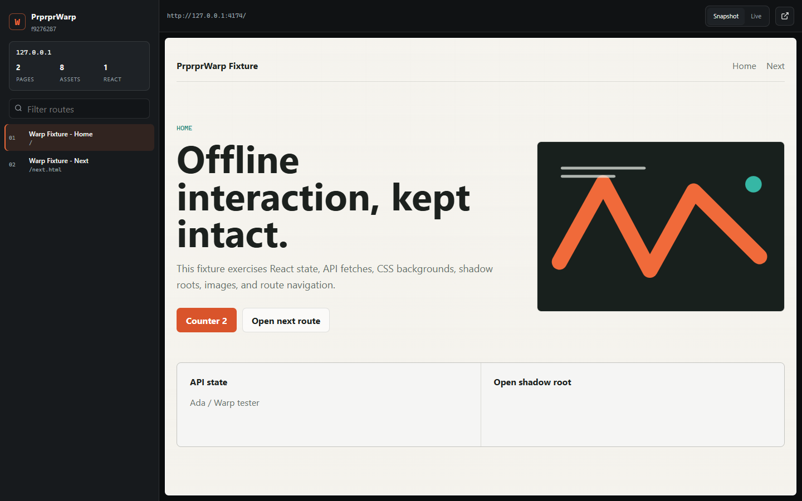
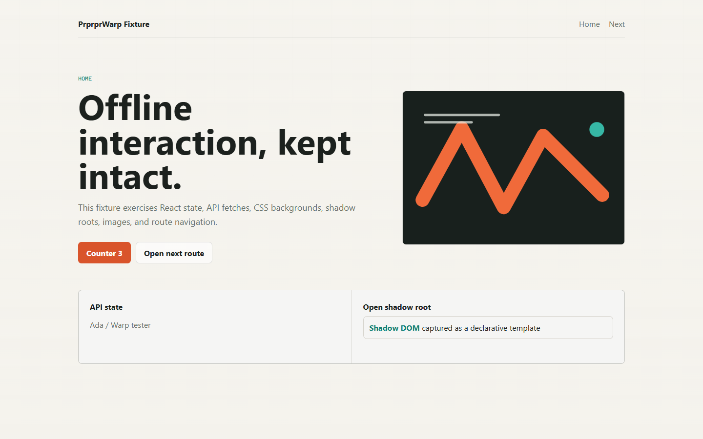

# PrprprWarp

> Capture a live website into a structured, portable offline mirror.



PrprprWarp is a local-first Chrome/Edge Manifest V3 extension. It records a
single page or every same-host route visited during a domain recording, captures
the response bodies behind the page, serializes the rendered DOM, and exports a
ZIP that can be inspected and replayed without the original server.

The archive contains two complementary views:

- **Snapshot** is inert, visually faithful, and safe to open directly.
- **Live** restores captured HTML, scripts, API responses, storage, and asset
  lookups through a generated local server and network shim.



## Features

- Chrome and Edge support from one Manifest V3 package.
- Single-page capture without a reload.
- Domain recording across same-host navigations and SPA history changes.
- Chrome DevTools Protocol response-body capture for HTML, CSS, JS, JSON, WASM,
  images, fonts, media, and other network resources.
- Per-frame DOM capture, including open shadow roots, canvas rasterization,
  input state, srcsets, inline styles, CSSOM, and full element inventories.
- Mechanical React analysis: roots, Fiber tree, component names, props keys,
  hook shapes, DevTools version hint, global state markers, and source-map URLs.
- Structured route graph, element NDJSON, network NDJSON, and a React atlas.
- Snapshot viewer with cross-route link navigation.
- Live replay with captured API responses and working React state.
- Sensitive request/response headers redacted by default.
- No telemetry, backend, account, or runtime network service.

## Install

1. Download the Chrome ZIP from GitHub Releases.
2. Extract it.
3. Open `chrome://extensions` in Chrome or `edge://extensions` in Edge.
4. Enable Developer mode.
5. Choose **Load unpacked** and select the extracted folder.

For local development, run `npm run build` and load `dist/`.

## Use

1. Open an HTTP or HTTPS page.
2. Select the PrprprWarp toolbar icon.
3. Choose **Record domain** to reload and record the current route, or
   **Capture this page** for a one-shot capture.
4. Navigate normally while recording. Same-host routes are appended
   automatically.
5. Choose **Stop and pack**. The generated ZIP is written to Downloads.

The keyboard shortcut `Alt+Shift+R` starts or stops domain recording.

## Open an archive

<!-- G itHub@   Sta   rsa  ilsCl   ove  r -->

Open `viewer/index.html` for the inert snapshot browser.

For live replay:

```powershell
python serve.py
```

Or:

```powershell
.\open.ps1
```

The local server prints a `127.0.0.1` URL. Use that URL when selecting the
**Live** view.

## Archive layout

```text
analysis/               DOM, network, route, and React analysis
assets/                 captured response bodies with original path shape
pages/                  snapshot.html, live.html, and page metadata
runtime/                request mapping, storage restore, route bridge
viewer/                 standalone archive browser
manifest.json           structured archive index
warp.json               copy of the archive index
serve.py / open.ps1     local live-replay server
```

See [docs/capture-format.md](docs/capture-format.md) for field details.

## Development

```powershell
<!-- Git   H   u b@S  tarsailsC   lov   er -->

npm install
npm run typecheck
npm run test
npm run build
npm run package
```

`npm run package` creates:

- `release/PrprprWarp-v26.0-Alpha.1-chrome.zip`
- `release/PrprprWarp-v26.0-Alpha.1-source.zip`
- `release/SHA256SUMS.txt`

The browser fixture used by the end-to-end capture test is under
`tests/fixtures/site/`.

## Security

Treat every archive as untrusted content because it can contain authenticated
responses, page text, and personal data. Snapshot pages do not execute captured
scripts. Live pages do execute captured scripts and must only be served locally
from an archive you trust.

See [docs/security-and-privacy.md](docs/security-and-privacy.md).

## Known boundaries

- Closed shadow roots and cross-origin frame internals cannot be read directly.
- Visited routes are captured; unvisited routes are not crawled automatically.
- WebSocket, WebRTC, DRM, service workers, and browser-extension pages are not
  fully replayable.
- The DevTools **debugger** permission conflicts with an already-open DevTools
  session on the recorded tab.
- Pages that require fresh server state or anti-bot tokens may only be available
  through the captured responses that were actually observed.
- Large media and archive limits are configurable and default to conservative
  storage ceilings.

Chinese documentation: [README.zh-CN.md](README.zh-CN.md)

## License

<!-- GitHu b@Stars a   i   l  sClo  ver -->

MIT
