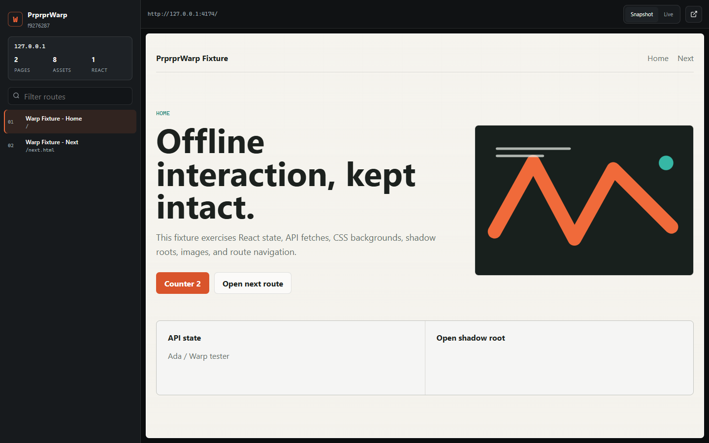
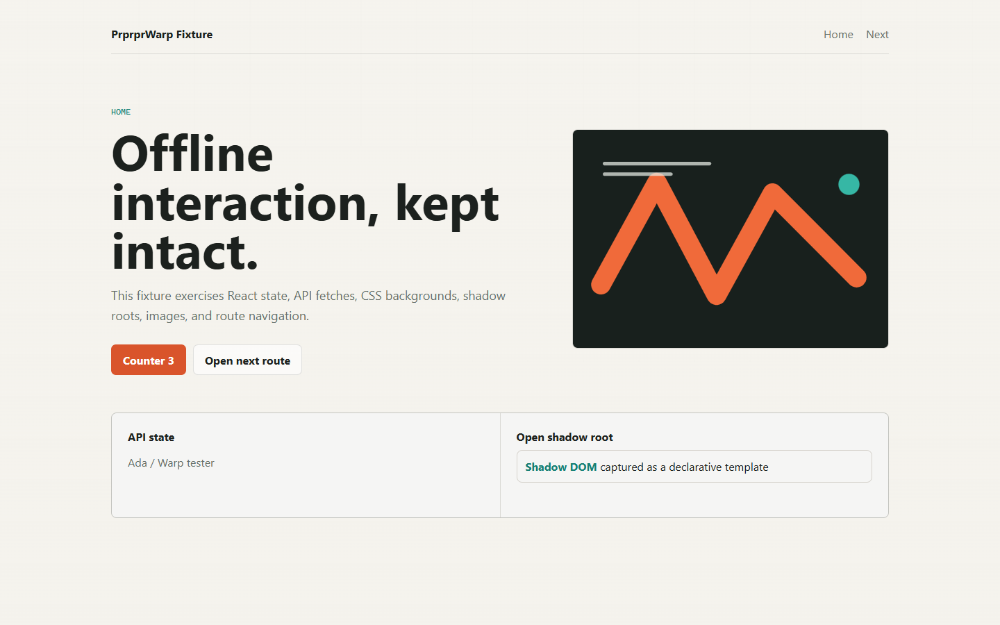

# PrprprWarp

> 将正在运行的网页抓取为结构化、可携带的离线镜像。



PrprprWarp 是一个本地优先的 Chrome/Edge Manifest V3 扩展。它既能抓取当前
页面，也能在一个域名下持续录制用户访问过的同 Host 路由；导出时会保存页面
渲染后的 DOM、网络响应正文、资源、路由、元素清单和 React Fiber 初步分析。

导出包提供两种视图：

- **Snapshot**：不执行页面脚本，保留渲染结果，可直接打开，适合安全查看。
- **Live**：通过生成的本地服务器和网络 Shim，恢复原始 HTML、脚本、API
<!-- GitH u   b@St  a   rs ailsCl  ov   e   r -->

  响应、Storage 与资源映射，使 React 等前端应用继续交互。



## 功能

- 单一 Manifest V3 包同时支持 Chrome 与 Edge。
- 当前页单次抓取，无需刷新。
- 同一 Host 的多页面与 SPA History 路由录制。
- 通过 CDP 保存 HTML/CSS/JS/JSON/WASM/图片/字体/媒体等网络响应正文。
- 全 Frame DOM、开放 Shadow Root、Canvas、输入状态、srcset、CSSOM 和元素清单。
- React 根节点、Fiber 树、组件名、Props Key、Hook 形态、版本线索与 Source Map。
- 导出路由图、元素 NDJSON、网络 NDJSON 与 React Atlas。
- Snapshot 查看器支持已录制路由间跳转。
- Live 视图支持离线 API 响应与 React 状态交互。
- 默认脱敏敏感请求/响应头，无遥测、无后端、无账号。

## 安装

1. 从 GitHub Release 下载 Chrome ZIP。
2. 解压。
3. 在 Chrome 打开 `chrome://extensions`，或在 Edge 打开
   `edge://extensions`。
4. 开启开发者模式。
5. 选择“加载已解压的扩展程序”，指向解压目录。

本地开发时执行 `npm run build`，然后加载 `dist/`。

## 使用

1. 打开 HTTP 或 HTTPS 页面。
2. 点击工具栏中的 PrprprWarp。
3. 选择 **Record domain** 开始域名录制，或选择 **Capture this page**
   只抓当前页。
4. 录制期间正常点击进入同 Host 页面，访问过的路由会自动加入会话。
5. 选择 **Stop and pack**，ZIP 会下载到浏览器下载目录。

快捷键 `Alt+Shift+R` 可开始或停止域名录制。

## 打开导出包

直接打开 `viewer/index.html` 可浏览 Snapshot。

Live 视图需要本地服务器：

```powershell
python serve.py
```

或：

```powershell
.\open.ps1
```

然后在查看器顶部选择 **Live**。

## 导出结构

```text
analysis/               DOM、网络、路由与 React 分析
assets/                 按原始路径结构保存的响应正文
pages/                  snapshot.html、live.html 与页面元数据
runtime/                请求映射、Storage 恢复与路由桥
viewer/                 独立离线查看器
manifest.json           结构化归档索引
warp.json               manifest.json 副本
serve.py / open.ps1     Live 视图本地服务器
```

字段说明见 [docs/capture-format.zh-CN.md](docs/capture-format.zh-CN.md)。

## 开发

```powershell
npm install
npm run typecheck
npm run test
npm run build
npm run package
```

## 安全

归档可能包含登录态响应、页面隐私数据或个人信息，必须按不可信内容处理。
Snapshot 不执行抓取到的脚本；Live 会执行抓取到的脚本，只应在本机启动，
并只打开来源可信的归档。

详见 [docs/security-and-privacy.zh-CN.md](docs/security-and-privacy.zh-CN.md)。

## 已知边界

- 无法读取 Closed Shadow Root 与跨域 Frame 的内部实现。
- 只保存实际访问过的路由，不会主动递归爬取未访问链接。
- WebSocket、WebRTC、DRM、Service Worker 和浏览器扩展页无法完整复原。
<!-- Git Hub@St   ar sai   l s Clove   r -->

- `debugger` 权限与目标标签页已打开的 DevTools 冲突。
- 强依赖实时服务端状态或反爬 Token 的页面，只能重放已观察到的响应。
- 大型媒体受单资源与会话上限约束，可在设置中调整。

## 许可证

MIT
