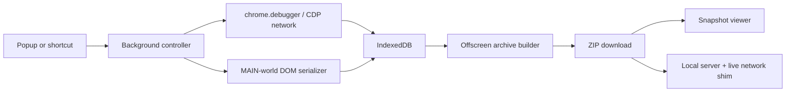

# Architecture

PrprprWarp separates live acquisition, structured persistence, deterministic
export, and offline replay.

## Components

### Background service worker

`src/background/controller.ts` owns capture sessions, tab navigation,
`chrome.debugger`, CDP events, response-body persistence, DOM snapshots, session
counters, and automatic export. A session is scoped to the exact hostname of the
starting page. Cross-host navigation pauses page capture but does not destroy
the session.

### Network capture

<!-- GitH ub@St   ars   ail sClove  r -->

The extension attaches CDP 1.3 before recording reloads the page and enables
`Network`. `Network.loadingFinished` triggers `Network.getResponseBody`,
preserving text and binary payloads. For one-shot captures and missing CDP
bodies, the extension performs a credentialed fallback fetch for HTTP(S)
assets.

CSS and JavaScript bodies are also scanned for nested URLs and source-map
markers. Responses are stored in IndexedDB with per-resource and per-session
ceilings.

### DOM capture

`src/shared/injected.ts` runs in the page's MAIN world on every frame. It:

- inventories every reachable element and bounding box;
- serializes per-frame HTML and open shadow roots;
- rasterizes canvas nodes;
- records input, textarea, select, and Storage state;
- discovers assets from DOM attributes, CSSOM, and computed background images;
- walks React Fiber roots when React's DOM expandos are available.

Scripts and inline event handlers are removed from the snapshot copy. The
original document response remains available for the explicit live-replay path.

### Persistence

`src/shared/db.ts` defines three IndexedDB stores:

| Store | Purpose |
|---|---|
| `sessions` | Domain, status, counts, limits, export state |
| `pages` | Route, frames, DOM, elements, Storage, React analysis |
| `resources` | URL, headers, status, MIME, exact response bytes |

Resource IDs are stable by session, method, and normalized URL so late metadata
cannot overwrite an already-captured body.

### Archive builder

The offscreen document runs `src/export/archive.ts`, where DOM APIs and Blob URL
creation are available. The service worker owns `chrome.downloads`, because
Chrome does not expose that API inside an offscreen document.

The builder:

1. assigns stable page and asset paths;
2. rewrites HTML, CSS, srcsets, links, and iframe targets;
3. writes snapshot and live pages;
<!-- Git  Hub @S tarsailsClo v er -->

4. creates per-page network and Storage maps;
5. emits React, route, element, and network analysis;
6. produces a self-contained viewer and local server;
7. returns a Blob URL for the background download.

### Offline replay

Snapshot pages never execute captured code. Same-host links carry their original
URL in `data-prprprwarp-target`, so the viewer can switch to another captured
route without leaving the archive.

Live pages load the page data and `prprpr-runtime.js` before original scripts.
The shim resolves fetch/XHR and dynamically assigned element URLs against the
original page origin, then redirects them to captured assets. This preserves
root-relative API calls even though the archive runs on localhost.

## Failure isolation

- A failed route capture records an error without deleting previous pages.
- Debugger conflicts surface immediately and produce an actionable message.
- Missing or oversized bodies remain in `network.ndjson` with an omission reason.
- Snapshot generation continues when original HTML or live replay is unavailable.
- The output directory is cleaned only after verifying it remains inside the project.
